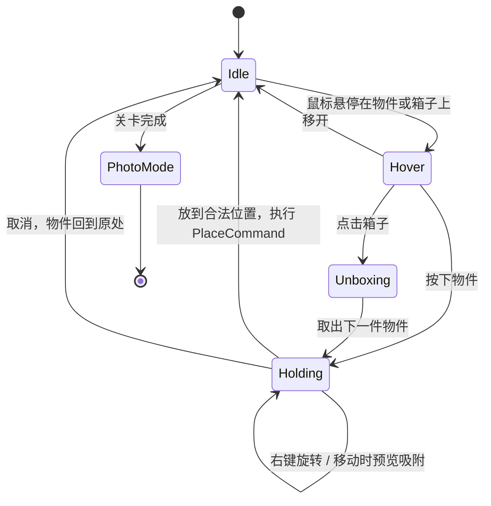
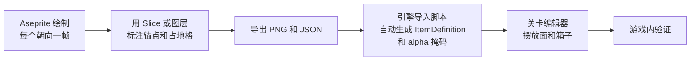

# 2.5D 房间放置游戏技术方案

> 参考对象：《焕家物语》（Unpacking，Witch Beam，2021）
> 文档状态：初稿 v0.1
> 更新日期：2026-10-14

---

## 目录

- [0. 结论速览](#0-结论速览)
- [1. 2.5D 实现方式](#1-25d-实现方式)
- [2. 引擎选择：Unity vs Godot](#2-引擎选择unity-vs-godot)
- [3. 整体架构设计](#3-整体架构设计)
- [4. 参考游戏、开源项目与学习资源](#4-参考游戏开源项目与学习资源)
- [5. 开发关键注意点](#5-开发关键注意点)
- [6. 里程碑计划](#6-里程碑计划)
- [7. 待确认事项](#7-待确认事项)

---

## 0. 结论速览

| 议题               | 结论                                                         |
| ------------------ | ------------------------------------------------------------ |
| 2.5D 方案          | **3D 逻辑网格 + 2D 等距像素精灵渲染**                        |
| 引擎               | 要上主机（尤其是 Switch）选 **Unity**；纯 PC 或 Web 的小团队选 **Godot** |
| 架构核心           | 领域逻辑层不依赖引擎；"面（Surface）"统一抽象；命令模式；只存逻辑状态 |
| 碰撞               | 不用物理引擎，全部用网格占用判断                             |
| 最大技术风险       | 投影、遮挡排序、像素级拾取这条链路，M0 阶段必须跑通          |
| 最容易被低估的工作 | 关卡/面编辑工具、美术导入管线、材质音效矩阵                  |

---

## 1. 2.5D 实现方式

Unpacking 看起来是 3D 房间，实际上是手绘的等距（Isometric）像素图，所有"立体感"都来自美术和绘制顺序。

| 方案                                 | 做法                                                         | 优点                                                         | 缺点                                                      |
| ------------------------------------ | ------------------------------------------------------------ | ------------------------------------------------------------ | --------------------------------------------------------- |
| A. 纯 2D 等距精灵                    | 全部用 2D 精灵，靠排序层和 Y 轴排序处理遮挡                  | 最接近 Unpacking 的画风                                      | 多格大物件的遮挡容易出错；鼠标坐标换算到"桌面/墙面"很麻烦 |
| B. 3D 正交相机 + 3D 模型             | 真 3D 场景，相机按等距角度俯视                               | 遮挡、碰撞、射线拾取都是现成的                               | 很难做出精致像素风；建模工作量大                          |
| **C. 3D 逻辑 + 2D 精灵渲染（推荐）** | 物件位置用 3D 网格坐标 `(x, y, z)` 存储，渲染时投影到屏幕并算出绘制顺序 | 画风和 A 一样，逻辑和 B 一样清晰；墙面、桌面、柜子内部统一处理 | 投影和排序要自己写（代码量不大）                          |

### 核心公式（2:1 等距）

```csharp
// 逻辑坐标 -> 屏幕坐标（像素）
screenX = (x - y) * TileW / 2;
screenY = (x + y) * TileH / 2 - z * TileZ;

// 绘制顺序：越靠前（x+y 越大）越晚画，同位置时高度大的后画
sortKey = (x + y) * 1000 + z * 10 + layerBias;
```

---

## 2. 引擎选择：Unity vs Godot

| 维度          | Unity 6                                                      | Godot 4.x                                                    |
| ------------- | ------------------------------------------------------------ | ------------------------------------------------------------ |
| 2D 像素工作流 | 成熟：Sprite Atlas、Pixel Perfect Camera、Sorting Group、URP 2D 光照 | 原生 2D 引擎，按像素坐标工作；内置像素对齐（snap 2D transforms to pixel） |
| 等距支持      | Isometric Tilemap、Custom Axis Sort                          | TileMapLayer 等距模式、`y_sort_enabled`                      |
| 语言          | C#（性能好、工具链成熟）                                     | GDScript 迭代快；也支持 C#，但 C# 项目目前不能导出 Web       |
| 生态          | Asset Store 很丰富（DOTween、Odin 等）                       | 插件较少，但能满足这类项目                                   |
| 主机发布      | 官方支持，流程成熟                                           | 需要通过 W4 Games 等第三方移植                               |
| 授权成本      | Personal 版年收入 20 万美元以下免费；Runtime Fee 已于 2024 年取消 | MIT 协议，完全免费，无分成                                   |
| 编辑器体量    | 重，启动和编译慢                                             | 轻量，打开就能用                                             |
| 招人 / 外包   | 容易                                                         | 相对难                                                       |
| 行业先例      | 据公开信息，Unpacking 是用 Unity 做的                        | 独立 2D 游戏越来越多                                         |

### 选择建议

- **选 Unity**：计划上主机（Switch 对这类治愈游戏很重要）；团队熟悉 C#；之后要扩团队或外包。
- **选 Godot**：1–3 人小团队；主攻 PC/Steam/Web；看重快速迭代和零授权成本。
- **补充说明**：这个类型的玩法对引擎要求不高（同屏物件只有几百个，没有复杂物理），引擎不是瓶颈。真正决定成败的是**自制关卡编辑工具**和**美术管线**。

---

## 3. 整体架构设计

### 3.1 分层架构

```mermaid
graph TD
    subgraph 表现层
        V1[ItemView 物件精灵]
        V2[SurfaceGizmo 面高亮]
        V3[UI 界面: HUD/菜单/相册]
        V4[音效与反馈 Juice]
    end
    subgraph 交互层
        I1[InputRouter 输入路由]
        I2[InteractionFSM 交互状态机]
        I3[Picker 像素级拾取]
    end
    subgraph 领域逻辑层 纯代码,不依赖引擎
        D1[PlacementService 放置判定]
        D2[SurfaceGrid 占用网格]
        D3[RuleEngine 合法性规则]
        D4[CommandStack 撤销/重做]
        D5[LevelState 关卡运行时状态]
    end
    subgraph 数据层
        A1[ItemDefinition 物件配置]
        A2[RoomDefinition 房间配置]
        A3[LevelDefinition 关卡配置]
        A4[SaveService 存档]
    end
    I1 --> I2
    I2 --> I3
    I2 --> D4
    D4 --> D1
    D1 --> D2
    D1 --> D3
    D5 --> A4
    D5 -- 事件 --> V1
    D5 -- 事件 --> V3
    D1 -- 读取 --> A1
    D5 -- 读取 --> A2
```

**核心原则：领域逻辑层不引用任何引擎的组件类型。** 好处：

1. 可以写单元测试；
2. 存档就是直接序列化这层的状态；
3. 以后换引擎只需重写表现层。

### 3.2 场景管理

|          | Unity                                                        | Godot                                                  |
| -------- | ------------------------------------------------------------ | ------------------------------------------------------ |
| 常驻服务 | `Boot` 场景 + `DontDestroyOnLoad`，放 GameManager / SaveService / AudioService | Autoload 单例：`GameState`、`SaveManager`、`EventBus`  |
| 关卡加载 | 一个通用的 `Gameplay` 场景，按 `LevelDefinition` 动态生成房间（推荐），或每关一个 Additive 场景 | 一个 `World` 节点下 `instantiate()` 房间的 PackedScene |
| 配置资产 | ScriptableObject                                             | 自定义 `Resource`（`.tres`）                           |

建议采用**数据驱动**：一关 = 若干房间 + 若干箱子 + 箱子里的物件列表，全部写在配置里，不要每关手搭场景。

### 3.3 物件放置系统

#### ① "面"（Surface）抽象

地板、墙面、桌面、书架的每一层、抽屉内部，都看成一张带自身坐标系的小网格。

```csharp
public enum SurfaceType { Floor, Wall, Top, Shelf, Inside, Hanging }

public class SurfaceDef {
    public string Id;
    public SurfaceType Type;
    public string RoomId;
    public Vector3 Origin;        // 面在房间 3D 逻辑空间中的原点
    public Vector3 AxisU, AxisV;  // 面的两个轴：地板为(X,Y)，墙面为(X,Z)
    public int Width, Height;     // 网格尺寸（建议用比地砖更细的子格）
    public string[] Tags;         // "kitchen_counter", "bathroom_shelf" ...
    public string OwnerItemId;    // 如果这个面属于某件家具（例如柜子），记录家具 id
}
```

#### ② 物件定义

```csharp
public class ItemDefinition {
    public string Id;
    public OrientationDef[] Orientations;   // 右键在这些朝向间循环
    public SurfaceType[] AllowedSurfaces;   // 能放在哪类面上
    public string[] PreferredTags;          // 例如牙刷只能放在 bathroom 相关的面
    public string Material;                 // "ceramic"、"plush"... 用来查音效
    public SurfaceDef[] ProvidedSurfaces;   // 家具本身提供的面（桌面、抽屉）
}

public class OrientationDef {
    public Vector2Int Footprint;  // 在面上占几格
    public int Height;
    public Sprite Sprite;         // 每个朝向一张图
    public Vector2 Pivot;         // 锚点固定在占地格的后角，这一点非常关键
}
```

#### ③ 放置判定流程

```csharp
PlacementResult CanPlace(ItemInstance item, SurfaceDef s, Vector2Int cell, int orient) {
    if (!item.Def.AllowedSurfaces.Contains(s.Type)) return Fail("面类型不允许");
    var fp = item.Def.Orientations[orient].Footprint;
    if (!grid[s.Id].InBounds(cell, fp))  return Fail("超出边界");
    if (grid[s.Id].IsOccupied(cell, fp, ignore: item.InstanceId)) return Fail("被占用");
    return Ok(isPreferred: rules.IsPreferred(item, s));  // "能放"和"放对了"分开判断
}
```

#### ④ 鼠标位置换算成"面"上的格子

1. 把各个面按绘制顺序**从前往后**遍历；
2. 已知面的高度和朝向，把屏幕坐标反投影到这个平面上，得到 `(u, v)`；
3. 第一个落在范围内、并且能通过 `CanPlace` 的面就是吸附目标。

#### ⑤ 关卡完成判定

- 所有箱子都清空，并且每件物件都在它的偏好位置上；
- 箱子清空后，放错的物件用红色描边提示；
- 注意："能放下"不等于"放对了"，这两个判断要分开。

### 3.4 交互状态机



- **像素级拾取**：物件之间大量重叠，必须按精灵的 alpha 判断点到了谁，而不是用矩形碰撞盒。建议在导入资源时为每张图预生成一个 1bit 掩码（Unity 用 `AssetPostprocessor`，Godot 用 `BitMap.create_from_image_alpha`），运行时不要直接读纹理。
- **命令模式**：`PlaceCommand`、`MoveCommand`、`RotateCommand`、`UnboxCommand`，撤销、重做和自动存档都基于它实现。

### 3.5 状态保存

#### 存档结构示例

```json
{
  "version": 3,
  "levelId": "level_02_college_dorm",
  "boxes": [{ "id": "box_1", "remaining": ["mug_02", "book_07"] }],
  "items": [
    { "iid": 17, "def": "mug_01", "loc": { "kind": "Surface", "surface": "desk_top", "cell": [2,1], "orient": 1 } },
    { "iid": 18, "def": "sock_03", "loc": { "kind": "Surface", "surface": "drawer_1_inside", "cell": [0,0], "orient": 0 } }
  ],
  "flags": { "tutorialDone": true }
}
```

#### 存档要点

- **只存逻辑状态，不存表现状态**：读档时由逻辑层重新生成视图；
- **自动存档**：每执行完一条命令，等约 0.5 秒再写盘（短时间内的多次操作只写一次）；
- **原子写入**：先写 `save.tmp` 再重命名，避免写到一半崩溃导致坏档；
- **版本号加迁移函数**：开发中改数据结构时，旧存档不至于失效；
- **序列化库**：Unity 用 Newtonsoft.Json（`JsonUtility` 不支持字典和多态）；Godot 用 `JSON.stringify` + `FileAccess`。

### 3.6 UI 与交互的组织方式

- UI 只通过事件订阅逻辑层（Unity 用 C# event 或 EventBus，Godot 用 signal），**不直接修改逻辑状态**，要改就发命令；
- 框架：Unity 6 菜单类界面可以用 UI Toolkit，游戏内跟随物件的提示用 uGUI 或世界空间精灵；Godot 用 Control + Theme；
- 这类游戏 UI 很少（HUD、暂停、相册、设置），不需要上 MVVM 这类重框架，MVP 或简单的事件驱动就够了。

### 3.7 推荐目录结构（以 Unity 为例）

```
Assets/
  _Project/
    Scripts/
      Core/         # EventBus、ServiceLocator、Command 基类
      Domain/       # Placement、Surface、Rules、LevelState（纯 C#，配 asmdef）
      Interaction/  # InputRouter、InteractionFSM、Picker
      Presentation/ # ItemView、IsoSorter、Juice
      UI/
      Save/
      Editor/       # 关卡与面的编辑工具（很重要）
    Data/
      Items/
      Rooms/
      Levels/
    Art/
      Sprites/Items/<category>/
      Rooms/
    Audio/
  Tests/
    EditMode/       # 放置规则的单元测试
```

> Godot 对应改成 `res://scripts/...`、`res://data/...`、`res://art/...`。

---

## 4. 参考游戏、开源项目与学习资源

### 4.1 参考游戏

| 游戏                      | 值得参考的地方                                   |
| ------------------------- | ------------------------------------------------ |
| Unpacking（焕家物语）     | 核心对标：面的划分、偏好位置规则、通过物品讲故事 |
| A Little to the Left      | 整理、排序类解谜，交互手感                       |
| Habbo Hotel               | 经典的等距房间家具摆放，网格加旋转               |
| 模拟人生（建造/购买模式） | 墙面和地面吸附、放置失败时的提示                 |
| 集合啦！动物森友会        | 家具摆放的操作手感，手柄如何操作网格             |
| Townscaper / Tiny Glade   | 吸附的反馈感，放下物件时的"爽感"                 |
| Monument Valley、Eastward | 等距构图、像素美术参考                           |

### 4.2 演讲与文章

- **GDC 2022《'Unpacking': The Fun Behind the Foley》**：讲游戏里约 14,000 个音效的设计（indienova 有中文整理）；
- **GDC 2022 Wren Brier 与 Tim Dawson 的分享**：讲如何用约 1000 件物品讲故事，以及设计和技术上的取舍（可以在 GDC Vault 或 YouTube 搜 "Unpacking GDC"）；
- **Red Blob Games**（redblobgames.com）：网格与坐标系的经典教程；
- **Clint Bellanger《Isometric Tiles Math》**、**Pikuma 的等距投影文章**：等距坐标换算；
- **shaunlebron/IsometricBlocks**（GitHub）：等距场景中多格方块的正确绘制顺序（包围盒拓扑排序）；
- **《Game Programming Patterns》**（Robert Nystrom，网上可免费阅读）：重点看 Command、Observer、State 三章。

### 4.3 开源项目与素材

- `godotengine/godot-demo-projects`：其中的 `2d/isometric` 等示例；
- `Unity-Technologies/2d-extras`：等距 Tilemap 相关扩展；
- **Sweet Home 3D**（开源，Java）：室内家具摆放、吸附和墙面逻辑可以参考；
- **Kenney.nl**：免费的等距家具素材（Furniture Kit 等），原型阶段先用它占位；
- **Lospec**：像素调色板库；
- **Aseprite**：像素美术工具（源码可得，可以自行编译）；
- 引擎学习：Unity Learn 的 2D 路线；GDQuest（Godot）。

---

## 5. 开发关键注意点

### 5.1 2.5D 视角与遮挡排序

- 坚持 **2:1 像素等距**（线条按两个像素横移一个像素竖移），美术和数学都最干净；
- **锚点统一**：每张物件图的 pivot 对准占地格的后角，再加一个固定偏移。锚点不统一是错位问题最常见的原因；
- 多格大物件（床、长桌）的排序容易出错，有两种办法：
  1. 规则排序：`sortKey` 按占地格中最靠前的那一格计算，小物件基本够用；
  2. 对动态物件做包围盒拓扑排序（同屏物件少，每帧排一次也很便宜）；
- 家具上的物件：给家具建一个排序组（Unity 的 Sorting Group，Godot 用子节点和 `z_index`），桌面上的物件在组内再排序；
- 墙面物件（海报、挂钩）单独放一个排序层，永远画在地面物件后面、墙体前面。

### 5.2 碰撞与网格对齐

- **不要用物理引擎**，所有占用判断都靠网格数组完成，结果确定、可以测试、也方便存档；
- **子格精度**：Unpacking 的摆放看起来很自由，其实是细网格。建议每块地砖再分 2×2 或 4×4 子格，兼顾自由度和规整感；
- **放置预览的三种状态**：绿色（可放且放对了）/ 白色（可放）/ 红色（不可放），并且对齐到像素，避免抖动；
- **旋转之后占地尺寸会变**（宽高互换），旋转时要重新判定；放不下就自动挪到最近的合法格子，不要直接拒绝。

### 5.3 性能优化

这类游戏的性能压力不大，但要注意：

- **Sprite Atlas 合批**：同一房间的物件打进同一张图集，减少 draw call；
- **透明区域的 overdraw**：房间背景大图要裁掉空白区域，Switch 和移动端对此很敏感；
- **只在需要时排序**：物件被移动、旋转或放下时才重算排序，不要每帧全量重排；
- **像素拾取只在悬停或点击时做**，并且只测试包围盒命中的少数几个物件；
- **Unity 注意 GC**：拖拽过程中避免 LINQ、字符串拼接和装箱；
- **纹理导入设置**：点采样（Point）、关闭 Mipmap、不压缩或使用无损格式，否则像素会糊或出现色块。

### 5.4 美术资源制作流程



- **先定规格再大规模出图**：基础网格尺寸（例如每格 16px）、像素缩放倍数、调色板、描边规则、光照方向；
- **命名规范**：`item_<类别>_<名字>_o<朝向>.png`，导入脚本靠文件名自动建配置；
- **优先做编辑器工具**（这是 Unpacking 类项目最容易被低估的部分）：在编辑器里可视化地给房间背景画"面"、设置标签、预览网格。Unity 用自定义 Inspector + Gizmos，Godot 用 `@tool` 脚本。没有这套工具，后期每件物件和每个面都要手调；
- **朝向数量**：每件物件 2–4 个朝向就够了，不用 8 个。不对称的物件（杯把、台灯）至少要画 2 个朝向。

### 5.5 手感与音效

- **材质矩阵音效**：放下物件时的音效由 `物件材质 × 面材质` 决定（陶瓷放在木头上、毛绒放在床上……）。从第一天就把这张查找表的结构定下来，内容以后再慢慢补；
- **反馈动效（Juice）**：拿起时轻微拉伸、放下时轻微压扁并带吸附回弹，开箱时有小动画，放错时有轻微抖动；
- **叙事靠物件本身**：同一件物品在不同关卡中出现（Unpacking 里的那只小猪），这需要配置系统支持"跨关卡同一物件"。

---

## 6. 里程碑计划

| 阶段              | 时长（参考） | 目标                                                 | 验收标准                           |
| ----------------- | ------------ | ---------------------------------------------------- | ---------------------------------- |
| M0 技术原型       | 1–2 周       | 1 个房间、地板加 1 张桌子、10 件占位物件             | 能拿起、旋转、吸附、放下，遮挡正确 |
| M1 核心玩法       | 3–4 周       | 箱子、墙面、柜子内部的面、合法性规则、撤销、自动存档 | 能从头到尾玩完一个房间并判定完成   |
| M2 工具与管线     | 2–3 周       | 面编辑器、Aseprite 导入脚本、材质音效表              | 美术能独立加物件，不需要程序参与   |
| M3 垂直切片       | 4–6 周       | 一整关（多个房间）、正式美术、音效、UI               | 可以拿去做外部试玩                 |
| M4 内容量产与打磨 | 视规模而定   | 多关卡、叙事、手柄适配、平台移植                     | 发布                               |

> **建议 M0 阶段就把"3D 逻辑网格、投影、排序、像素拾取"这条技术链路跑通**，它是整个项目最大的技术风险。

---

## 7. 待确认事项

- [ ] **目标平台**：只做 PC，还是要上 Switch 或移动端？（决定选 Unity 还是 Godot）
- [ ] **团队规模和技术背景**：是否熟悉 C#？有没有专职的像素美术？
- [ ] **玩法差异**：是完全照着 Unpacking 的规则做，还是有自己的创新点（例如自由摆放、多人合作、经营元素）？
- [ ] **美术规格**：基础网格像素尺寸、目标分辨率、调色板